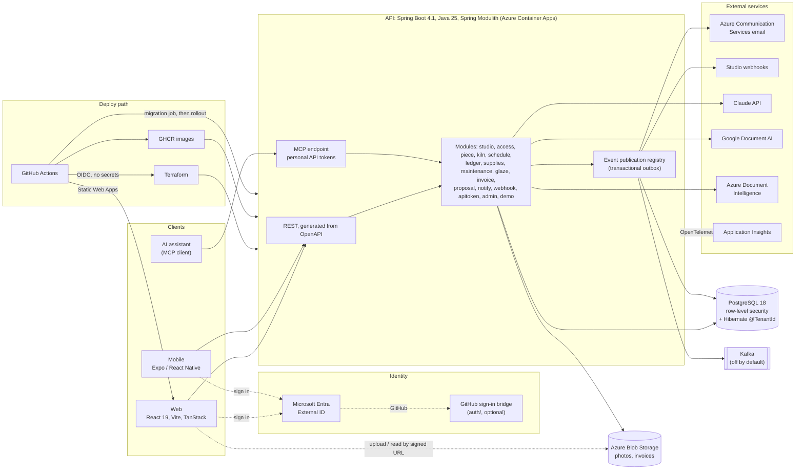

# studiomanager

[](https://github.com/AaronFilson/studiomanager/actions/workflows/ci.yml)
[](https://github.com/AaronFilson/studiomanager/actions/workflows/codeql.yml)
[](https://github.com/AaronFilson/studiomanager/actions/workflows/deploy-dev.yml)
[](LICENSE)

Studiomanager runs a community pottery studio. It tracks pieces from greenware to pickup, loads
kilns, charges firing fees, keeps the books, and watches supplies and equipment. It is built to
help a studio manager, or to stand in for one: an AI assistant can read the studio's data and
propose changes over MCP, and staff approve them. The backend is a Spring Boot modular monolith
on Java 25 and PostgreSQL. The clients are a React web app and an Expo mobile app.

**Status:** a dev environment runs on Azure (West US), deployed by CI on every merge to `main`.
No studio uses it yet. The [first-deploy runbook](docs/runbooks/first-deploy.md) takes an empty
Azure subscription to a running environment. The current plan is the
[pre-production cleanup](docs/planning/20-pre-production-cleanup-plan.md).

## Feature tour

- **Today.** One page with what's in the kilns, who's on duty, and what needs doing.
- **Pieces.** Each piece moves from greenware through bisque and glaze to pickup, with photos and
  a hold period for unclaimed work.
- **Kilns.** Queues with per-member caps, kiln loads, a firing log, and one "ready" notice per
  batch.
- **Money.** A double-entry ledger: member balances, stored value, firing fees, tax by date,
  consignment sales, payables to artists and instructors, and a journal export.
- **Supplies.** Clay and supplies with par levels, purchase requests and sales to members.
- **Schedule.** Duties, expiring certifications, a bookable calendar and rosters with credited
  hours.
- **Maintenance.** Recurring tasks for kilns, equipment and the building, counted in days or
  firings, with reminders and problem reports from a phone.
- **Glaze book.** The studio's glaze recipes, line by line.
- **Imports.** Members and consignment items from a CSV file.
- **Invoices.** Upload a supplier invoice and a reader pulls out the lines for review. Three
  readers are available: Claude (with the studio's own key), Google Document AI and Azure Document
  Intelligence. "Compare readers" shows their answers side by side.
- **Assistant.** Personal API tokens let an assistant connect over MCP. It reads freely, but
  changes arrive as suggestions that staff approve or reject.
- **Webhooks and events.** Signed outbound webhooks to a studio's own tools, and an optional Kafka
  event stream.
- **Platform admin.** Per-studio limits on the platform-paid invoice readers, with temporary boosts.
- **Demo studio.** "Demo Clay Co.", seeded with members, kilns, pieces and more, to try the app on.

## Architecture



### In more detail

- **One deployable, many modules.** Spring Modulith verifies the module boundaries in a test
  ([ADR 2](docs/adr/0002-modular-monolith.md)). That test also writes Modulith's generated module
  diagrams (PlantUML) to `api/build/spring-modulith-docs/`.
- **Tenant isolation in two layers.** PostgreSQL row-level security sits under every
  studio-owned table. The tenant is bound per transaction from a Java 25 `ScopedValue`, and the
  app refuses to start if its database login could bypass RLS
  ([ADR 3](docs/adr/0003-tenant-isolation-with-row-level-security.md)). On the write side,
  Hibernate's `@TenantId` fills in and filters the studio too
  ([ADR 21](docs/adr/0021-hibernate-with-tenant-id-for-the-write-side.md)).
- **OpenAPI first.** The server interfaces and the TypeScript client are generated from
  [`studiomanager.yaml`](api/src/main/openapi/studiomanager.yaml). Drift fails the build
  ([ADR 4](docs/adr/0004-openapi-first-contract.md)).
- **Money is double-entry,** and the database refuses unbalanced entries
  ([ADR 9](docs/adr/0009-double-entry-ledger.md)).
- **Outbox for side effects.** Email, webhooks and the Kafka stream go through Spring Modulith's
  event publication registry, so nothing is sent for work that rolled back and nothing is lost
  when a send fails ([ADR 11](docs/adr/0011-transactional-outbox-for-email.md),
  [14](docs/adr/0014-outbound-webhooks.md), [15](docs/adr/0015-event-streaming-to-kafka.md)).
- **MCP with propose and approve.** The MCP endpoint runs on the official MCP Java SDK
  ([ADR 22](docs/adr/0022-mcp-on-the-official-sdk.md)). Assistants sign in with personal API
  tokens ([ADR 19](docs/adr/0019-personal-api-tokens.md)). A change an assistant proposes waits as
  a pending action, and approving it runs the normal service call as the person who approved.
- **Invoice readers** sit behind one interface: Claude, Google Document AI and Azure Document
  Intelligence. Google is reached keylessly from Azure by workload identity federation
  ([ADR 18](docs/adr/0018-invoice-readers.md), [24](docs/adr/0024-platform-admin-and-live-settings.md)).
- **Identity** comes from Microsoft Entra External ID; the API is a plain OAuth resource server
  ([ADR 7](docs/adr/0007-identity-with-entra-external-id.md)). A small bridge app adds GitHub
  sign-in ([ADR 20](docs/adr/0020-github-sign-in-bridge.md)).
- **No stored secrets.** The API reaches Postgres through its managed identity, and migrations run
  as a separate job under a separate identity
  ([ADR 5](docs/adr/0005-passwordless-database-and-migration-job.md)). GitHub Actions signs in to
  Azure through OIDC federation and applies Terraform
  ([ADR 6](docs/adr/0006-terraform-and-keyless-ci.md)).
- **Azure Container Apps** run the API and scale to zero. A JVM AOT cache trained in the image
  build shortens cold starts ([ADR 8](docs/adr/0008-jvm-aot-cache-for-cold-starts.md)).

## Engineering practices

- **NullAway** runs through **Error Prone** on every compile, in JSpecify mode. Error Prone's
  other checks are not on yet.
- **Spotless** with google-java-format; the Gradle build checks it.
- **Testcontainers integration tests** against real PostgreSQL and Kafka, run in CI.
- **CodeQL** on pushes, pull requests and weekly; **Dependabot** for updates.
- **Terraform** is checked in CI (fmt, validate, `terraform test`, TFLint) and planned on PRs.
- **ADRs** record each decision: [docs/adr](docs/adr).
- **Web and mobile:** CI type-checks, lints, tests and builds them, and fails if the generated
  client is out of date. The web tests use Vitest, Testing Library and MSW.

## Repository layout

| Path | What |
|---|---|
| [`api/`](api) | Spring Boot 4.1 on Java 25: Spring Modulith, PostgreSQL 18, Flyway, Hibernate |
| [`auth/`](auth) | The GitHub sign-in bridge |
| [`packages/api-client/`](packages/api-client) | Generated TypeScript client and TanStack Query options |
| [`web/`](web) | React 19, Vite, TanStack Router and Query, MSAL |
| [`mobile/`](mobile) | Expo and React Native |
| [`infra/`](infra) | Terraform for Azure (and the Google Document AI project) |
| [`.github/workflows/`](.github/workflows) | CI, CodeQL, and deploy on merge |
| [`docs/`](docs) | ADRs, plans, runbooks and the pilot kit |

## Running locally

You need JDK 25, Node 24, and Docker for the database and the integration tests. In this repo,
builds and tests run through the scripts in [`scripts/`](scripts), from the repo root:

```sh
bash scripts/check.sh                  # everything: API, generated client, web
bash scripts/api.sh                    # API build and tests
bash scripts/api.sh bootRun            # any Gradle task, e.g. run the API on :8080
bash scripts/js.sh -r run test         # API client and web tests
bash scripts/integration.sh test       # API with Docker integration tests, inside WSL
bash scripts/web-linux.sh              # the CI web job in a node:24 container
```

The scripts find a JDK 25 and run the pinned pnpm. `docker compose up -d` starts PostgreSQL 18
with the app's database roles. Signing in needs an Entra External ID tenant and two app
registrations; steps 1 to 4 of the [first-deploy runbook](docs/runbooks/first-deploy.md) set them
up, and the free tier is enough. Copy `web/.env.example` to `web/.env.local` for the web app.

After changing the API contract, regenerate the client with
`bash scripts/js.sh --filter @studiomanager/api-client run generate` and commit the result.

## Screenshots

Not captured yet. The planned screens and file names are listed in
[docs/screenshots](docs/screenshots/README.md).

<!--
When the images exist, replace this section with:


-->

## Further reading

- [Architecture decision records](docs/adr)
- [Plans and research](docs/planning), including the
  [pre-production cleanup plan](docs/planning/20-pre-production-cleanup-plan.md)
- [Runbooks](docs/runbooks)

## License

[MIT](LICENSE)
